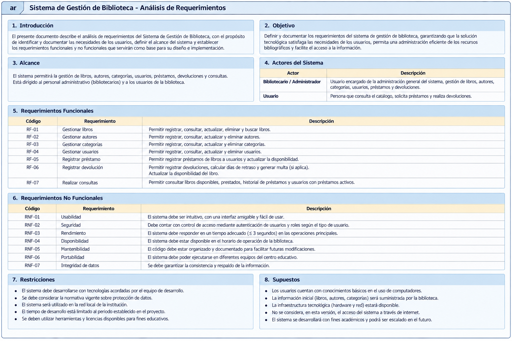
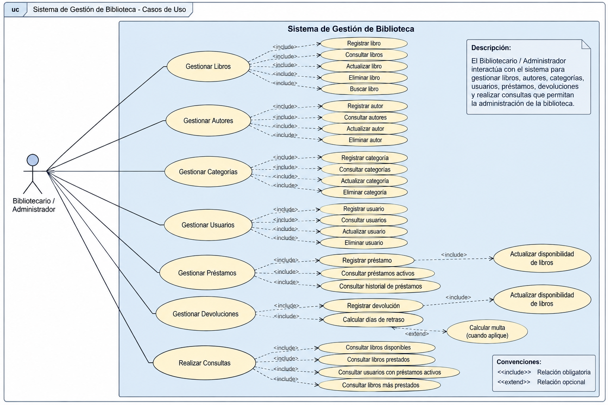
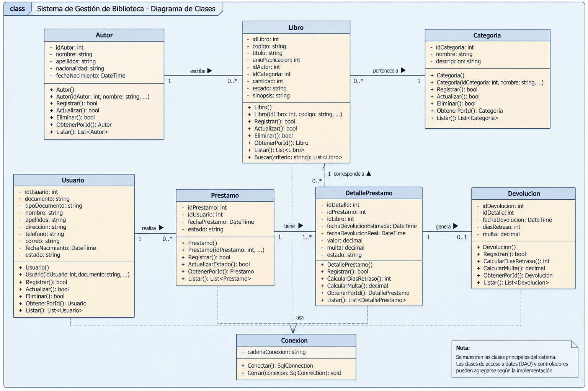
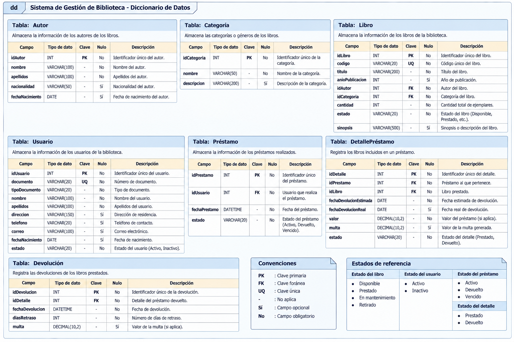
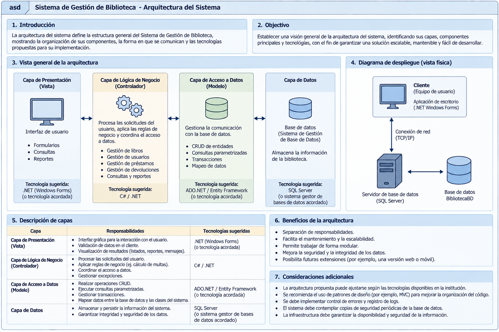

# ACA -- Programación Avanzada

# Sistema de Gestión de Biblioteca

------------------------------------------------------------------------

## PORTADA

**Corporación Unificada Nacional de Educación Superior CUN**

**Ingeniería de Sistemas**

### ACA -- Programación Avanzada

### Sistema de Gestión de Biblioteca

**Elaborado por:**\
Andryn Jair Ramirez Moreno

**Docente:**\
Veronica Castro

**Fecha:**\
Bogotá, 8 de noviembre de 2026

------------------------------------------------------------------------

# CONTRAPORTADA

**Sistema de Gestión de Biblioteca**

Trabajo presentado como evidencia para la asignatura **Programación Avanzada**. Durante su desarrollo se aplicaron conceptos de Programación Orientada a Objetos, bases de datos relacionales, operaciones CRUD, validaciones, tratamiento de excepciones y conexión con SQL Server.

**Estudiante:** Andryn Jair Ramirez Moreno

**Programa:** Ingeniería de Sistemas

**Grupo:** 54469

**Docente:** Veronica Castro

**Institución:** Corporación Unificada Nacional de Educación Superior CUN

**Año:** 2026

------------------------------------------------------------------------

# TABLA DE CONTENIDO

1.  Introducción
2.  Objetivos
3.  Planteamiento del problema
4.  Análisis de requerimientos
5.  Casos de uso
6.  Diagrama de clases
7.  Diccionario de datos
8.  Arquitectura del sistema
9.  Explicación de los módulos desarrollados
10. Capturas de pantalla del sistema
11. Pruebas de funcionamiento
12. Conclusiones
13. Recomendaciones
14. Referencias bibliográficas

------------------------------------------------------------------------

# 1. INTRODUCCIÓN

El presente documento describe el diseño y la implementación del Sistema de Gestión de Biblioteca, una aplicación de escritorio desarrollada en C# con Windows Forms y SQL Server que permite administrar libros, autores, editoriales, usuarios y préstamos, manteniendo el control de las existencias disponibles de cada libro.

**Gestión de Libros**

Este módulo permite administrar el catálogo de la biblioteca mediante las siguientes operaciones:

Registrar libros nuevos.
Consultar la información de los libros ya registrados.
Modificar los datos de un libro.
Eliminar libros del sistema.
Buscar un libro por su ISBN.

Cada libro almacena la siguiente información:

ISBN
Título
Autor
Editorial
Categoría
Año de publicación
Existencias disponibles

**Gestión de Autores**

El sistema también permite administrar los autores registrados:

Agregar autores nuevos.
Consultar los autores existentes.
Actualizar la información de los autores.
Eliminar autores del registro.

Cada autor almacena su nombre y apellido.

**Gestión de Editoriales**

El sistema permite administrar las editoriales asociadas a los libros:

Registrar editoriales nuevas.
Consultar las editoriales existentes.
Actualizar el nombre de una editorial.
Eliminar editoriales del registro.

**Control de Existencias**

El programa lleva el control de los ejemplares disponibles de cada libro:

La cantidad de existencias se descuenta automáticamente al registrar un préstamo.
La cantidad de existencias se incrementa nuevamente al registrar una devolución.

**Gestión de Préstamos**

Permite controlar los préstamos realizados a los usuarios de la biblioteca:

Registrar préstamos de libros.
Registrar devoluciones.
Consultar los préstamos registrados.

Información registrada:

Libro prestado (ISBN)
Usuario
Fecha de préstamo
Fecha de devolución
Estado del préstamo (Prestado o Devuelto)

**Consultas y Reportes**

El sistema incorpora consultas que facilitan la gestión:

Búsqueda de libros por ISBN.
Listado general de libros, autores, editoriales, usuarios y préstamos.
Reportes de préstamos activos, préstamos devueltos e inventario de libros.

El sistema fue desarrollado con **C#, .NET 10, Windows Forms, SQL Server, Microsoft.Data.SqlClient y FontAwesome.Sharp**, aplicando los principios de la Programación Orientada a Objetos y una organización por capas.

------------------------------------------------------------------------

# 2. OBJETIVOS

## 2.1 Objetivo general

Construir un Sistema de Gestión de Biblioteca que permita administrar de forma eficiente la información de libros, autores, editoriales, usuarios y préstamos a través de operaciones CRUD, de manera que se facilite el control de las existencias, la consulta de la información y el seguimiento de los ejemplares prestados.

## 2.2 Objetivos específicos

-   Diseñar e implementar una aplicación de escritorio para la gestión de una biblioteca.
-   Aplicar los principios de la Programación Orientada a Objetos.
-   Diseñar e implementar una base de datos relacional en SQL Server.
-   Implementar operaciones CRUD para las entidades principales.
-   Implementar validaciones de datos.
-   Implementar consultas que faciliten la administración de la biblioteca.
-   Utilizar Git y GitHub para el control de versiones.
-   Documentar técnica y funcionalmente el proyecto.

------------------------------------------------------------------------

# 3. PLANTEAMIENTO DEL PROBLEMA

## 3.1 Descripción del problema

Una institución educativa necesita una aplicación de escritorio que le ayude a administrar los procesos de su biblioteca. La gestión de libros, autores, editoriales y usuarios, así como el control de préstamos y devoluciones, exige un sistema organizado que permita registrar, consultar, actualizar y eliminar información, además de hacer seguimiento al estado de los préstamos y generar reportes. Para cubrir esta necesidad se propone desarrollar un Sistema de Gestión de Biblioteca con C#, Windows Forms y SQL Server. La aplicación centralizará la información bibliográfica, permitirá administrar los usuarios, gestionar los préstamos y las devoluciones, y consultar la información por medio de reportes, garantizando la integridad y la consistencia de los datos almacenados.

## 3.2 Alcance

El sistema permitirá:

-   Gestionar libros.
-   Gestionar autores.
-   Gestionar editoriales.
-   Gestionar usuarios.
-   Registrar préstamos.
-   Registrar devoluciones.
-   Consultar la disponibilidad de los libros según sus existencias.
-   Consultar el historial de préstamos.
-   Generar reportes de préstamos activos, préstamos devueltos e inventario de libros.

------------------------------------------------------------------------

# 4. ANÁLISIS DE REQUERIMIENTOS

## 4.1 Descripción general

El Sistema de Gestión de Biblioteca permitirá administrar la información relacionada con libros, autores, editoriales, usuarios y préstamos, y controlar los procesos de registro, consulta, actualización, eliminación, préstamo y devolución, garantizando la integridad de los datos almacenados en SQL Server.



## 4.2 Actores del sistema

| Actor | Descripción |
| --- | --- |
| Bibliotecario / Administrador | Persona encargada de administrar el catálogo de libros, los autores, las editoriales y los usuarios, así como de registrar los préstamos y las devoluciones. Tiene acceso a todos los módulos del sistema. |

## 4.3 Requerimientos funcionales

| Código | Requerimiento | Descripción |
| --- | --- | --- |
| RF01 | Gestionar libros | Registrar, consultar, actualizar, eliminar y buscar libros por ISBN. |
| RF02 | Gestionar autores | Registrar, consultar, actualizar y eliminar autores. |
| RF03 | Gestionar editoriales | Registrar, consultar, actualizar y eliminar editoriales. |
| RF04 | Gestionar usuarios | Registrar, consultar, actualizar y eliminar usuarios. |
| RF05 | Registrar préstamos | Registrar un préstamo y descontar las existencias del libro. |
| RF06 | Registrar devoluciones | Registrar la fecha de devolución, cambiar el estado del préstamo y reponer las existencias del libro. |
| RF07 | Consultas y reportes | Consultar libros por ISBN, listar la información registrada y generar reportes de préstamos activos, préstamos devueltos e inventario de libros. |

## 4.4 Requerimientos no funcionales

| Código | Requerimiento | Descripción |
| --- | --- | --- |
| RNF01 | Usabilidad | La interfaz debe ser clara, sencilla y fácil de utilizar. |
| RNF02 | Validación | El sistema debe validar la información ingresada por el usuario. |
| RNF03 | Mantenibilidad | El código debe estar organizado y documentado. |
| RNF04 | Organización por capas | El sistema debe mantener separadas la interfaz y el acceso a datos. |
| RNF05 | Manejo de excepciones | Las operaciones deben manejar errores de forma controlada mediante `try`/`catch`. |
| RNF06 | Integridad de datos | La información debe mantenerse consistente en la base de datos. |
| RNF07 | Consultas parametrizadas | Las consultas a la base de datos deben utilizar parámetros. |

## 4.5 Reglas de negocio

### RN01 -- ISBN único del libro

No se admitirá el registro de dos libros con el mismo ISBN, ya que es la clave primaria de la tabla `Libros`.

### RN02 -- Datos obligatorios

No será posible guardar un registro con campos obligatorios vacíos. La aplicación exige todos los campos del formulario, aunque la base de datos permita valores nulos en algunos de ellos.

### RN03 -- Usuario existente

Un préstamo no podrá registrarse si el usuario no existe.

### RN04 -- Libro existente

Un préstamo no podrá registrarse si el libro no existe.

### RN05 -- Disponibilidad

No se prestará un libro cuando sus existencias sean iguales a cero.

### RN06 -- Actualización de existencias al prestar

Al registrar un préstamo, las existencias del libro se decrementan en una unidad.

### RN07 -- Actualización de existencias al devolver

Al registrar una devolución, las existencias del libro se incrementan en una unidad.

### RN08 -- Devolución única

Un préstamo que ya tiene estado "Devuelto" no puede volver a devolverse.

------------------------------------------------------------------------

# 5. CASOS DE USO

## 5.1 Descripción

El bibliotecario interactúa con el sistema a través del menú principal, desde donde accede a los módulos de inicio, libros, usuarios, autores, editoriales, préstamos y reportes. Cada módulo permite realizar las operaciones propias de su entidad y muestra los resultados en una grilla.

## 5.2 Diagrama de casos de uso



## 5.3 Descripción de casos de uso

### CU01 -- Gestionar libros

**Actor principal:** Bibliotecario / Administrador

**Descripción:** Permite registrar, consultar, actualizar, eliminar y buscar libros por ISBN.

**Precondiciones:** - El usuario debe tener acceso al sistema.

**Flujo principal:** 1. El actor ingresa al módulo de libros. 2. El sistema muestra los libros registrados en la grilla. 3. El actor selecciona la operación que desea realizar (nuevo, guardar, editar, eliminar o buscar). 4. El sistema valida los datos y ejecuta la operación. 5. El sistema muestra el resultado y actualiza la grilla.

**Flujos alternativos:** - Campos obligatorios vacíos: el sistema muestra un mensaje de advertencia. - Año o existencias no numéricos: el sistema muestra un mensaje de validación. - ISBN ya registrado: la base de datos rechaza el registro y el sistema muestra el error.

**Postcondiciones:** - El libro queda registrado, actualizado o eliminado según la operación realizada.

------------------------------------------------------------------------

### CU02 -- Registrar préstamo

**Actor principal:** Bibliotecario / Administrador

**Descripción:** Permite registrar el préstamo de un libro a un usuario.

**Precondiciones:** - El usuario debe existir. - El libro debe existir. - El libro debe tener existencias disponibles.

**Flujo principal:** 1. Seleccionar el usuario. 2. Seleccionar el libro. 3. Indicar la fecha del préstamo. 4. Verificar que las existencias sean mayores que cero. 5. Registrar el préstamo con estado "Prestado". 6. Descontar una unidad de las existencias. 7. Mostrar confirmación.

**Flujos alternativos:** - Usuario o libro sin seleccionar: el sistema muestra un mensaje de advertencia. - Libro sin existencias: el sistema no permite el préstamo.

**Postcondiciones:** - El préstamo queda registrado con estado "Prestado". - Las existencias del libro quedan actualizadas.

------------------------------------------------------------------------

### CU03 -- Registrar devolución

**Actor principal:** Bibliotecario / Administrador

**Descripción:** Permite registrar la devolución de un libro prestado.

**Precondiciones:** - Debe existir un préstamo con estado "Prestado".

**Flujo principal:** 1. Seleccionar el préstamo en la grilla. 2. Indicar la fecha de devolución. 3. Verificar que el préstamo no haya sido devuelto. 4. Confirmar la operación. 5. Cambiar el estado del préstamo a "Devuelto". 6. Incrementar una unidad en las existencias del libro. 7. Mostrar confirmación.

**Flujos alternativos:** - El préstamo ya fue devuelto: el sistema no permite registrar la devolución nuevamente. - No se seleccionó la fecha de devolución: el sistema muestra un mensaje de advertencia.

**Postcondiciones:** - La devolución queda registrada. - Las existencias del libro quedan actualizadas.

------------------------------------------------------------------------

# 6. DIAGRAMA DE CLASES

## 6.1 Descripción

El sistema está compuesto por los formularios de la interfaz, la clase de conexión a la base de datos y la clase de arranque del programa. Cada formulario concentra las operaciones de su módulo y utiliza la clase `Conexion` para comunicarse con SQL Server.

## 6.2 Diagrama de clases



## 6.3 Principales clases

| Clase | Responsabilidad |
| --- | --- |
| Program | Punto de entrada de la aplicación; inicia el formulario principal. |
| FrmPrincipal | Formulario contenedor con el menú y la navegación entre módulos. |
| FrmInicio | Pantalla de bienvenida del sistema. |
| FrmLibros | Registrar, consultar, actualizar, eliminar y buscar libros por ISBN. |
| FrmAutores | Registrar, consultar, actualizar y eliminar autores. |
| FrmEditoriales | Registrar, consultar, actualizar y eliminar editoriales. |
| FrmUsuarios | Registrar, consultar, actualizar y eliminar usuarios. |
| FrmPrestamos | Registrar préstamos y devoluciones, y consultar los préstamos. |
| FrmReportes | Generar reportes de préstamos activos, préstamos devueltos e inventario de libros. |
| Conexion | Proporcionar la conexión a la base de datos SQL Server. |

## 6.4 Aplicación de POO

En el proyecto se aplicaron los siguientes conceptos:

-   **Clases:** cada formulario y la clase `Conexion` son clases que agrupan datos y comportamiento.
-   **Objetos:** se crean instancias como `new FrmLibros()`, `new FrmPrestamos()` y `new Conexion()`.
-   **Constructores:** cada formulario ejecuta `InitializeComponent()` y carga sus datos iniciales en el constructor.
-   **Métodos:** por ejemplo `CargarLibros()`, `CargarUsuarios()`, `btnGuardar_Click()` y `ObtenerConexion()`.
-   **Propiedades:** se utilizan propiedades de los controles como `Text`, `DataSource`, `DisplayMember` y `SelectedValue`.
-   **Encapsulamiento:** la cadena de conexión (`cadenaConexion`) y la variable `modoEdicion` se declaran como privadas dentro de sus clases.
-   **Herencia:** los formularios heredan de la clase `Form` de Windows Forms.
-   **Colecciones:** se utilizan `DataTable` y `DataGridView` para manejar y mostrar los registros.
-   **Polimorfismo y sobrecarga:** no fueron necesarios para las funcionalidades implementadas.

------------------------------------------------------------------------

# 7. DICCIONARIO DE DATOS

## 7.1 Convenciones

| Abreviatura | Significado |
| --- | --- |
| PK | Clave primaria |
| FK | Clave foránea |
| UQ | Campo con valor único |
| NULL | Campo que puede estar vacío |
| NOT NULL | Campo obligatorio |

## 7.2 Tabla: Autores

| Campo | Tipo de dato | Clave | Nulo | Descripción |
| --- | --- | --- | --- | --- |
| IdAutor | INT | PK | No | Identificador único del autor (autoincremental). |
| Nombre | VARCHAR(100) | \- | No | Nombre del autor. |
| Apellido | VARCHAR(100) | \- | No | Apellido del autor. |

## 7.3 Tabla: Editoriales

| Campo | Tipo de dato | Clave | Nulo | Descripción |
| --- | --- | --- | --- | --- |
| IdEditorial | INT | PK | No | Identificador único de la editorial (autoincremental). |
| Nombre | VARCHAR(150) | \- | No | Nombre de la editorial. |

## 7.4 Tabla: Libros

| Campo | Tipo de dato | Clave | Nulo | Descripción |
| --- | --- | --- | --- | --- |
| ISBN | VARCHAR(20) | PK | No | Identificador único del libro. |
| Titulo | VARCHAR(200) | \- | No | Título del libro. |
| IdAutor | INT | FK | No | Autor del libro (referencia a Autores.IdAutor). |
| IdEditorial | INT | FK | No | Editorial del libro (referencia a Editoriales.IdEditorial). |
| Categoria | VARCHAR(100) | \- | Sí | Categoría o género del libro. |
| Anio | INT | \- | Sí | Año de publicación. |
| Existencias | INT | \- | No | Cantidad de ejemplares disponibles. |

## 7.5 Tabla: Usuarios

| Campo | Tipo de dato | Clave | Nulo | Descripción |
| --- | --- | --- | --- | --- |
| IdUsuario | INT | PK | No | Identificador único del usuario (autoincremental). |
| Nombre | VARCHAR(100) | \- | No | Nombre del usuario. |
| Apellido | VARCHAR(100) | \- | No | Apellido del usuario. |
| Documento | VARCHAR(30) | UQ | No | Número de documento del usuario. |
| Telefono | VARCHAR(30) | \- | Sí | Teléfono de contacto. |
| Correo | VARCHAR(150) | \- | Sí | Correo electrónico. |

## 7.6 Tabla: Prestamos

| Campo | Tipo de dato | Clave | Nulo | Descripción |
| --- | --- | --- | --- | --- |
| IdPrestamo | INT | PK | No | Identificador único del préstamo (autoincremental). |
| IdUsuario | INT | FK | No | Usuario que realiza el préstamo (referencia a Usuarios.IdUsuario). |
| ISBN | VARCHAR(20) | FK | No | Libro prestado (referencia a Libros.ISBN). |
| FechaPrestamo | DATE | \- | No | Fecha en que se realizó el préstamo. |
| FechaDevolucion | DATE | \- | Sí | Fecha real de la devolución; NULL mientras el préstamo está activo. |
| Estado | VARCHAR(20) | \- | No | Estado del préstamo: "Prestado" o "Devuelto". |



> **IMPORTANTE:** este diccionario corresponde al script `Querys BD - AcaBiblioteca.txt`. Si la base de datos cambia, esta sección debe actualizarse.

------------------------------------------------------------------------

# 8. ARQUITECTURA DEL SISTEMA

## 8.1 Descripción general

El Sistema de Gestión de Biblioteca se organiza en capas con el fin de separar la interfaz de la comunicación con la base de datos y facilitar su mantenimiento:

1.  Capa de Presentación.
2.  Capa de Acceso a Datos.
3.  Capa de Base de Datos.

La lógica de negocio (validaciones y reglas) se implementa dentro de los formularios, antes de ejecutar las consultas.

## 8.2 Diagrama de arquitectura



## 8.3 Capa de Presentación

**Responsabilidad:**

Es la capa a través de la cual el usuario interactúa con el sistema. Contiene los formularios, los controles y las validaciones de entrada.

**Componentes:**

-   FrmPrincipal (formulario contenedor con el menú principal)
-   FrmInicio (pantalla de inicio)
-   FrmLibros (gestión de libros)
-   FrmAutores (gestión de autores)
-   FrmEditoriales (gestión de editoriales)
-   FrmUsuarios (gestión de usuarios)
-   FrmPrestamos (registro y control de préstamos y devoluciones)
-   FrmReportes (reportes de préstamos e inventario)

**Tecnología utilizada:**

-   C#
-   Windows Forms
-   .NET 10
-   FontAwesome.Sharp (íconos del menú)

## 8.4 Capa de Lógica de Negocio

**Responsabilidad:**

Se encarga de aplicar las validaciones y reglas del sistema. En este proyecto se implementa dentro de los métodos de cada formulario.

**Componentes:**

-   Métodos de validación de `FrmLibros`, `FrmAutores`, `FrmEditoriales`, `FrmUsuarios` y `FrmPrestamos`.
-   Métodos de carga de datos (`CargarLibros`, `CargarAutores`, `CargarEditoriales`, `CargarUsuarios`, `CargarPrestamos`).

**Reglas aplicadas:**

-   Validar campos obligatorios y tipos de datos numéricos.
-   Verificar que el libro tenga existencias antes de prestarlo.
-   Verificar que el préstamo no haya sido devuelto antes de registrar la devolución.
-   Actualizar las existencias al prestar y al devolver.
-   Solicitar confirmación antes de eliminar registros.

## 8.5 Capa de Acceso a Datos

**Responsabilidad:**

Gestiona la comunicación entre la aplicación y SQL Server.

**Componentes:**

-   `Conexion` (carpeta `Datos`): proporciona la conexión a la base de datos mediante `ObtenerConexion()`.
-   Consultas SQL parametrizadas implementadas en cada formulario con `SqlCommand`, `SqlDataAdapter` y `SqlDataReader`.

**Tecnologías utilizadas:**

-   SQL Server.
-   Microsoft.Data.SqlClient.
-   Consultas parametrizadas con `@parámetro`.

## 8.6 Capa de Base de Datos

La información del sistema se almacena en:

**Base de datos:** `AcaBiblioteca`

**Tablas principales:**

-   Autores
-   Editoriales
-   Libros
-   Usuarios
-   Prestamos

## 8.7 Flujo de información

``` text
Usuario
   ↓
Formularios (validaciones)
   ↓
Conexion / ADO.NET
   ↓
SQL Server
```

Las respuestas de la base de datos recorren el camino inverso hasta volver a la interfaz.

------------------------------------------------------------------------

# 9. EXPLICACIÓN DE CADA MÓDULO DESARROLLADO

## 9.1 Módulo de libros

**Objetivo:** administrar el catálogo de libros de la biblioteca.

**Funcionalidades:** - Listar los libros registrados. - Buscar un libro por ISBN. - Registrar un libro. - Editar un libro (seleccionando el registro en la grilla). - Eliminar un libro con confirmación.

**Validaciones:** - Todos los campos son obligatorios. - El año y las existencias deben ser números enteros. - El ISBN no puede repetirse.

## 9.2 Módulo de autores

**Objetivo:** administrar los autores registrados.

**Funcionalidades:** - Registrar. - Consultar. - Actualizar. - Eliminar.

**Validaciones:** - Nombre y apellido obligatorios.

## 9.3 Módulo de editoriales

**Objetivo:** administrar las editoriales asociadas a los libros.

**Funcionalidades:** - Registrar. - Consultar. - Actualizar. - Eliminar.

**Validaciones:** - El nombre de la editorial es obligatorio.

## 9.4 Módulo de usuarios

**Objetivo:** administrar los usuarios de la biblioteca.

**Funcionalidades:** - Registrar. - Consultar. - Actualizar. - Eliminar.

**Validaciones:** - Todos los campos del formulario son obligatorios. - El documento no puede repetirse.

## 9.5 Módulo de préstamos

**Objetivo:** registrar y controlar los préstamos de libros.

**Funcionalidades:** - Registrar préstamo (usuario, libro y fecha). - Verificar la disponibilidad de existencias. - Descontar existencias al prestar. - Consultar los préstamos registrados. - Eliminar préstamos con confirmación.

## 9.6 Módulo de devoluciones

**Objetivo:** registrar la devolución de los libros prestados. Se gestiona dentro de `FrmPrestamos`.

**Funcionalidades:** - Seleccionar un préstamo activo. - Indicar la fecha de devolución. - Cambiar el estado del préstamo a "Devuelto". - Incrementar las existencias del libro.

## 9.7 Módulo de consultas y reportes

**Consultas implementadas:**

-   Búsqueda de libros por ISBN.
-   Listado de libros.
-   Listado de autores.
-   Listado de editoriales.
-   Listado de usuarios.
-   Listado de préstamos.

**Reportes implementados (`FrmReportes`):**

-   Préstamos activos: préstamos con estado "Prestado", mostrando usuario, ISBN, título y fecha de préstamo.
-   Préstamos devueltos: préstamos con estado "Devuelto", mostrando usuario, ISBN, título, fecha de préstamo y fecha de devolución.
-   Inventario de libros: ISBN, título, autor, editorial, categoría, año y existencias de cada libro.

**Funcionamiento:** el usuario selecciona el tipo de reporte en la lista desplegable y pulsa "Generar"; el resultado se carga en la grilla. El botón "Limpiar" borra la selección y los resultados.

------------------------------------------------------------------------

# 10. CAPTURAS DE PANTALLA DEL SISTEMA

Esta sección reúne las evidencias de las principales funcionalidades del sistema, tomadas directamente de la aplicación en ejecución.

## 10.1 Menú principal


**Descripción:** pantalla principal del sistema. En el costado izquierdo se encuentra el menú de navegación con acceso a los módulos de Inicio, Libros, Usuarios, Autores, Editoriales, Préstamos y Reportes; el área central muestra el módulo seleccionado. Desde aquí el bibliotecario accede a todas las funcionalidades de la aplicación.

## 10.2 Gestión de libros


**Descripción:** módulo que permite administrar el catálogo. Muestra la grilla con los libros registrados y los campos ISBN, título, autor, editorial, categoría, año y existencias. Permite registrar un libro nuevo, editar el registro seleccionado, eliminar con confirmación y buscar un libro por su ISBN.

## 10.3 Gestión de autores


**Descripción:** módulo para administrar los autores. Presenta la grilla con los autores registrados y los campos nombre y apellido, y permite registrar, consultar, actualizar y eliminar autores.

## 10.4 Gestión de editoriales


**Descripción:** módulo para administrar las editoriales asociadas a los libros. Muestra la grilla con las editoriales registradas y permite registrar, consultar, actualizar y eliminar editoriales.

## 10.5 Gestión de usuarios


**Descripción:** módulo para administrar los usuarios de la biblioteca. Muestra la grilla con los usuarios registrados y los campos nombre, apellido, documento, teléfono y correo, y permite registrar, consultar, actualizar y eliminar usuarios. El documento no puede repetirse.

## 10.6 Registro de préstamos y devoluciones


**Descripción:** módulo que controla los préstamos. En él se selecciona el usuario y el libro, se indica la fecha del préstamo y el sistema verifica las existencias antes de registrar el préstamo con estado "Prestado", descontando una unidad. También permite registrar la devolución de un préstamo activo indicando la fecha, cambiar su estado a "Devuelto" y reponer las existencias del libro. La grilla muestra los préstamos registrados.

## 10.7 Consultas y reportes


**Descripción:** módulo de reportes. El usuario selecciona el tipo de reporte en la lista desplegable (Préstamos activos, Préstamos devueltos o Inventario de libros) y pulsa "Generar"; el resultado se carga en la grilla. El botón "Limpiar" borra la selección y los resultados.

> **Nota:** las capturas corresponden a la carpeta `Capturas de pantalla` y muestran funcionalidades reales del sistema.

------------------------------------------------------------------------

# 11. PRUEBAS DE FUNCIONAMIENTO

## 11.1 Estrategia de pruebas

Se verificó el funcionamiento de cada módulo ingresando datos válidos e inválidos, comprobando los mensajes de validación y confirmando en la base de datos que las operaciones de inserción, actualización y eliminación se aplicaran correctamente.

## 11.2 Casos de prueba

| ID | Funcionalidad | Entrada / Acción | Resultado esperado | Resultado obtenido | Estado |
| --- | --- | --- | --- | --- | --- |
| CP01 | Registrar libro | Datos válidos | Libro registrado correctamente | Exitoso | Exitoso |
| CP02 | Registrar libro | ISBN repetido | Mostrar mensaje de error por clave duplicada | Exitoso | Exitoso |
| CP03 | Registrar usuario | Datos válidos | Usuario registrado | Exitoso | Exitoso |
| CP04 | Registrar usuario | Documento repetido | Mostrar mensaje de error por valor único | Exitoso | Exitoso |
| CP05 | Registrar préstamo | Libro con existencias | Préstamo registrado y existencias descontadas | Exitoso | Exitoso |
| CP06 | Registrar préstamo | Libro sin existencias | No permitir el préstamo | Exitoso | Exitoso |
| CP07 | Registrar devolución | Préstamo activo | Estado "Devuelto" y existencias incrementadas | Exitoso | Exitoso |
| CP08 | Registrar devolución | Préstamo ya devuelto | No permitir la devolución | Exitoso | Exitoso |
| CP09 | Buscar libro | ISBN existente | Cargar los datos del libro en el formulario | Exitoso | Exitoso |
| CP10 | Buscar libro | ISBN inexistente | Mostrar mensaje de libro no encontrado | Exitoso | Exitoso |
| CP11 | Generar reporte | Tipo "Préstamos activos" y clic en Generar | Cargar en la grilla los préstamos con estado "Prestado" | Exitoso | Exitoso |
| CP12 | Generar reporte | Sin tipo de reporte seleccionado y clic en Generar | Mostrar mensaje de advertencia y no generar el reporte | Exitoso | Exitoso |

## 11.3 Evidencias de pruebas

Las evidencias de las pruebas se adjuntarán como capturas de pantalla de la aplicación en ejecución.

### Prueba CP01

*Captura pendiente de adjuntar.*

**Resultado:** Exitoso. El libro se registró correctamente y apareció en la grilla con los datos ingresados.

### Prueba CP02

*Captura pendiente de adjuntar.*

**Resultado:** Exitoso. El sistema rechazó el registro y mostró el mensaje de error por ISBN duplicado.

------------------------------------------------------------------------

# 12. CONCLUSIONES

## Conclusión 1

El desarrollo del Sistema de Gestión de Biblioteca permitió obtener una aplicación de escritorio funcional que centraliza la administración de libros, autores, editoriales, usuarios, préstamos y devoluciones. Con ello se reducen los errores propios del registro manual y se agilizan tareas como la consulta de disponibilidad, el control de las existencias y el seguimiento de los ejemplares prestados, cumpliendo el objetivo general planteado al inicio del proyecto.

## Conclusión 2

La aplicación de los principios de Programación Orientada a Objetos fue fundamental para organizar la solución: se trabajó con clases como los formularios y `Conexion`, se utilizaron constructores, propiedades y métodos, y el encapsulamiento permitió proteger datos internos como la cadena de conexión. Esto dio como resultado un código más comprensible, reutilizable y fácil de mantener.

## Conclusión 3

El diseño de la base de datos relacional en SQL Server, junto con la organización por capas, permitió separar la interfaz de la comunicación con la base de datos. El uso de claves primarias y foráneas, consultas parametrizadas y el manejo controlado de excepciones garantizó la integridad y consistencia de la información, además de facilitar el mantenimiento y la evolución del sistema.

## Conclusión 4

Durante el desarrollo surgieron dificultades relacionadas con la configuración de la conexión a la base de datos, la validación de la disponibilidad de los ejemplares y la sincronización de estados al registrar préstamos y devoluciones. Estas se resolvieron mediante pruebas constantes, el uso de consultas parametrizadas, el control de excepciones y la organización del trabajo con Git y GitHub, lo que fortaleció tanto la calidad del sistema como las competencias adquiridas en el curso.

------------------------------------------------------------------------

# 13. RECOMENDACIONES
## recomendaciones Futuras
Incorporar reservas de libros y renovación de préstamos en línea.
## Recomendaciones de Seguridad
-   Gestionar usuarios con roles y permisos (administrador, bibliotecario)
-  Generar reportes exportables a PDF y Excel, además de un panel con indicadores (libros más prestados, préstamos activos, morosos).
-  Registrar una auditoría de las operaciones (quién registró o modificó cada préstamo y cuándo).
-  Añadir gestión de multas pagadas/pendientes y su historial por usuario.

------------------------------------------------------------------------

# 14. REFERENCIAS BIBLIOGRÁFICAS

> Utilizar **Normas APA, última edición**.

Ejemplos de formato:

**Libro:**

Apellido, N. (Año). *Título del libro*. Editorial.

**Página web:**

Autor/Organización. (Año). *Título del recurso*. URL

**Documentación técnica:**

Microsoft. (s. f.). *Documentación de Windows Forms para .NET*. Microsoft Learn. https://learn.microsoft.com/dotnet/desktop/winforms/

> **Importante:** incluir únicamente las fuentes que realmente fueron consultadas durante el desarrollo del proyecto.

------------------------------------------------------------------------

# ANEXOS

## Anexo A. Repositorio GitHub

**Repositorio:** https://github.com/AndrynRamirez/AcaBiblioteca

## Anexo B. Script de base de datos

**Archivo:** `Querys BD - AcaBiblioteca.txt`

## Anexo C. Evidencia de Git y GitHub

Insertar capturas que evidencien:

-   Creación del repositorio.
-   Commits realizados.
-   Organización del proyecto.
-   Publicación del código.
-   README.md.

------------------------------------------------------------------------

# LISTA DE VERIFICACIÓN ANTES DE ENTREGAR

-   [ ] Portada.
-   [ ] Contraportada.
-   [ ] Introducción.
-   [ ] Objetivos.
-   [ ] Tabla de contenido.
-   [ ] Numeración de páginas.
-   [ ] Planteamiento del problema.
-   [ ] Análisis de requerimientos.
-   [ ] Casos de uso.
-   [ ] Diagrama de casos de uso.
-   [ ] Diagrama de clases.
-   [ ] Diccionario de datos.
-   [ ] Arquitectura del sistema.
-   [ ] Diagrama de arquitectura.
-   [ ] Explicación de cada módulo.
-   [ ] Capturas de pantalla.
-   [ ] Pruebas de funcionamiento.
-   [ ] Conclusiones.
-   [ ] Recomendaciones.
-   [ ] Referencias bibliográficas en formato APA.
-   [ ] Código fuente completo.
-   [ ] Script de base de datos.
-   [ ] Datos de prueba.
-   [ ] Repositorio GitHub.
-   [ ] README.md.
-   [ ] Evidencia de commits.

------------------------------------------------------------------------

## NOTA PARA EL ESTUDIANTE

Este documento funciona como una **plantilla de apoyo**. Antes de la entrega se deben reemplazar todos los textos que aparecen entre `[corchetes]`, quitar las instrucciones y ajustar cada sección a las funcionalidades que en realidad se desarrollaron.

La documentación debe guardar coherencia con:

1.  El código fuente.
2.  La base de datos.
3.  El diagrama de clases.
4.  Los casos de uso.
5.  La arquitectura implementada.
6.  Las capturas y pruebas realizadas.

**No se deben documentar funcionalidades que no hayan sido implementadas.**
